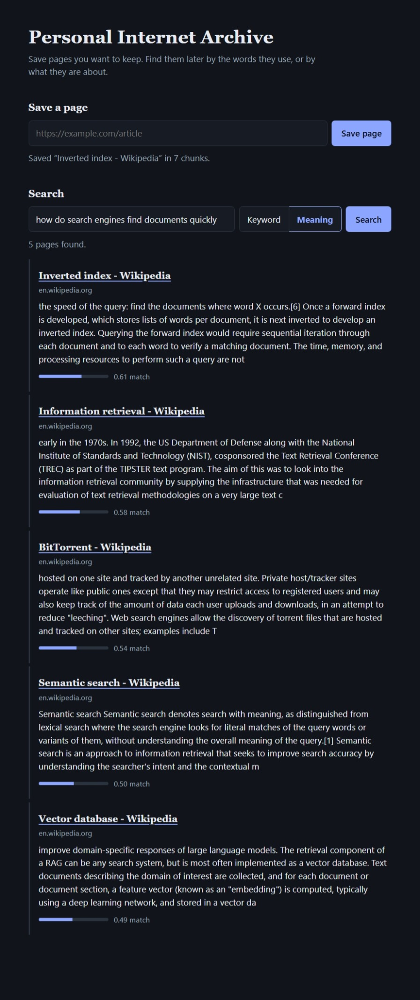

# Personal Internet Archive

A self-hosted archive for web pages. Save a URL, and the page's text is extracted and stored locally. You can then search it two ways: by keyword, or by meaning (semantic search), with the embedding model running on your own machine.



## Features

- Save any web page by URL and extract its readable text
- Store pages locally in SQLite
- Keyword search with highlighted snippets (SQLite FTS5)
- Semantic search: pages are split into chunks, embedded locally, and ranked by meaning
- Re-saving a URL updates the stored copy instead of duplicating it
- Simple web UI at `/` with keyword and meaning search
- REST API with interactive docs (FastAPI)

## How it works

1. **Fetch and extract:** `httpx` downloads the page and `trafilatura` pulls out the readable text.
2. **Store:** the text goes into SQLite, with an FTS5 index for keyword search.
3. **Chunk and embed:** the text is split into overlapping ~150-word chunks, and each chunk is turned into a vector with `all-MiniLM-L6-v2`.
4. **Search by meaning:** the query is embedded the same way, and chunks are ranked by cosine similarity. Results show the best chunk per page, and weak matches are filtered out.

## Tech stack

| Piece | Tool |
|---|---|
| Language | Python 3.11 |
| API | FastAPI + Uvicorn |
| Fetching | httpx |
| Text extraction | trafilatura |
| Storage and keyword search | SQLite with FTS5 |
| Embeddings | sentence-transformers (all-MiniLM-L6-v2), numpy |
| Frontend | Plain HTML, CSS and JavaScript (no framework) |

## Getting started

```bash
conda create -n pia python=3.11 -y
conda activate pia
pip install fastapi uvicorn httpx trafilatura sentence-transformers numpy
python -m uvicorn archive.main:app --reload
```

Then open <http://127.0.0.1:8000/> for the web UI, or <http://127.0.0.1:8000/docs> for the interactive API docs.

The first save or semantic search after starting the server takes a few seconds while the embedding model loads. The very first run also downloads the model (about 90 MB).

> Some sites reject requests without an identifying User-Agent (Wikipedia is one). Edit `HEADERS` in `archive/fetch.py` and add your own contact details before saving pages.

## API

| Method | Endpoint | Description |
|---|---|---|
| GET | `/` | Web UI |
| POST | `/save` | Body: `{"url": "https://..."}`. Fetches, extracts, chunks, embeds and stores the page. |
| GET | `/search?q=term&limit=10` | Keyword search. Returns URL, title and a snippet with matches marked. |
| GET | `/semantic-search?q=...&limit=5` | Search by meaning. Returns the best-matching chunk per page with a similarity score. |

## Project structure

```
archive/
├── fetch.py        # download a page and extract its text
├── chunk.py        # split page text into overlapping chunks
├── embed.py        # turn text into vectors (sentence-transformers)
├── db.py           # SQLite storage, FTS5 keyword search, semantic search
├── main.py         # FastAPI app and routes
└── static/
    └── index.html  # web UI
docs/
└── screenshot.jpeg
test_m1.py          # end-to-end check: fetch, store, keyword search
test_embed.py       # checks that the embedding model loads and works
test_m2.py          # chunks saved pages and tests semantic search
```

## Roadmap

- [x] **M1:** save, extract, store and keyword search
- [x] **M2:** chunk pages, generate embeddings locally, search by meaning
- [x] **M3:** web UI
- [ ] **M4:** saved-pages list with delete, tags, raw HTML snapshots

## Why this project

It is the retrieval layer for a larger project: an agentic RAG assistant that reasons over the archive.
